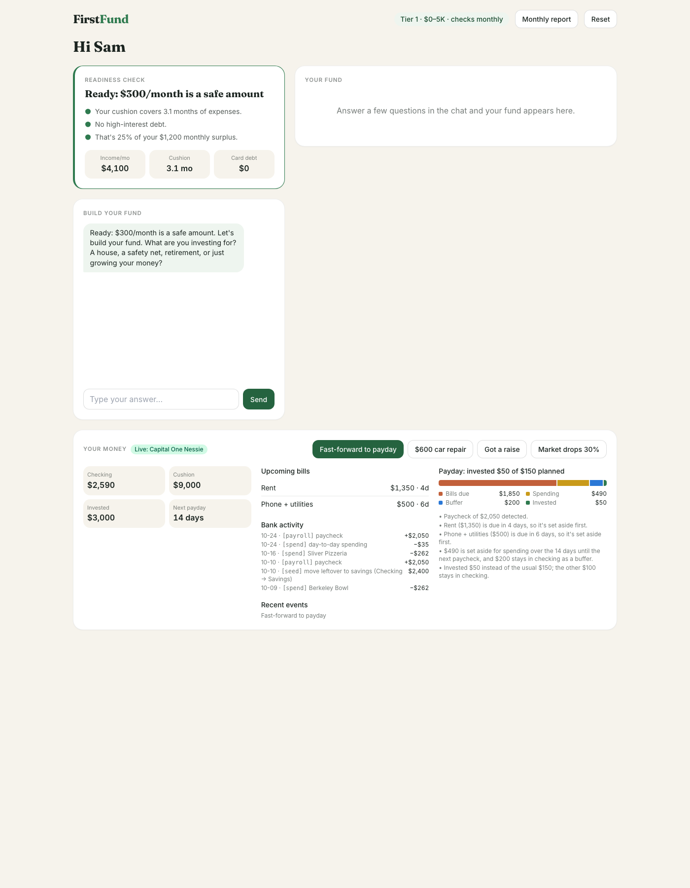
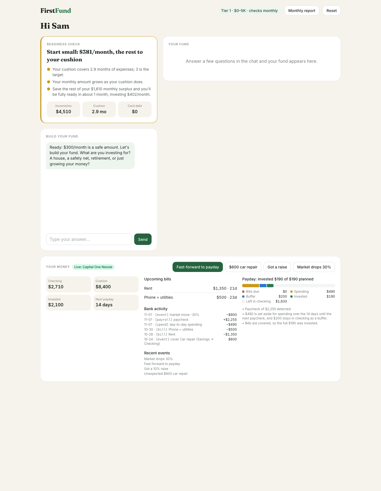

# FirstFund

**Every paycheck invests itself, but never before rent is paid.**

Built for **Best Use of Nessie (Capital One)** at Cal Hacks. Judged on completeness, creativity and complexity.

FirstFund is an investing assistant for people who have never invested. It connects to a bank
account (Capital One's **Nessie** API), works out whether you can afford to invest at all, and then,
on every payday, looks at the bills due before your next paycheck and invests only what is truly
left over. If rent is due in four days, it invests less. If something goes wrong (a $600 car repair,
a market crash), the numbers change on screen and Claude explains why in plain English.



*Sam on real Nessie: the paycheck landed, rent and phone are due in 4 and 6 days, so FirstFund
invested $50 of the $150 it planned. Every number in that panel was computed from Nessie
transactions.*

---

## Contents

1. [The problem](#the-problem)
2. [What it does](#what-it-does)
3. [How we use Nessie](#how-we-use-nessie)
4. [How it works](#how-it-works)
5. [Setup](#setup)
6. [Running the demo](#running-the-demo)
7. [Testing](#testing)
8. [Deploy (Render)](#deploy-render)
9. [Project layout and owners](#project-layout-and-owners)
10. [Known limits](#known-limits)

---

## The problem

Most first-time investing advice is "set up an automatic transfer every month." That advice ignores
how money actually moves for someone on a paycheck: rent lands on the 1st, the paycheck lands on the
14th, and a fixed auto-invest can drain checking right before a bill. People get burned once, overdraw,
and stop investing.

FirstFund answers two questions from real bank data:

1. **Should you invest at all yet?** If you have high-interest card debt or under three months of
   expenses saved, the answer is "not yet" or "start small", with the reason and the next step.
2. **How much is safe *this* payday?** Not a fixed monthly number: whatever is left after the bills
   due before the next paycheck, two weeks of spending and a $200 buffer.

## What it does

| Feature | What you see |
|---|---|
| **Readiness check** | "Ready", "Start small" or "Not yet", with income, cushion (months of expenses saved) and card debt pulled from the bank |
| **Payday safety check** | On payday: which bills are set aside, how much spending is reserved, the buffer, and what got invested, shown as a colored breakdown bar plus plain-English reasons |
| **Life-event buttons** | Fast-forward to payday, a $600 car repair, a 10% raise, a 30% market drop. Each one writes real transactions to Nessie, and every panel recalculates |
| **Bank activity feed** | The persona's recent Nessie transactions (paychecks, bills, spending, moves between accounts) |
| **Live / offline badge** | "Live: Capital One Nessie", "Demo data", or "Nessie offline: demo data" if the bank drops mid-demo |
| **Fund builder (chat)** | A short Claude conversation (goal, timeline, how you'd react to a loss) that builds an ETF portfolio |
| **Crash test** | "The market just fell 30%: sell, hold or buy?" with a 10-year simulation of each choice |
| **Monthly report** | A Claude-written summary email of the month, with every number supplied by Python |
| **Tiers** | The product scales from $0–5K (check monthly) up to $50K+, with different rebalancing rules per tier |

**Ground rule: Claude never invents a number.** Every number on screen is rendered from a Python
result. Claude's text sits beside the numbers and explains them, and it is told to add no new ones.

### The four personas

Each persona is a real Nessie customer with four accounts and two months of history.

| Persona | Situation | What FirstFund says |
|---|---|---|
| **Maria** | First job, $1,200 card balance at 25% APR | *Not yet:* pay off the card first, it costs more than investing earns |
| **Jordan** | Steady paycheck, thin cash cushion | *Start small:* $25/month, the rest builds the cushion |
| **Sam** | Stable, $9K saved, $3K invested | *Ready:* but payday invests $50, not $150, because rent is due in 4 days |
| **Alex** | $65K invested (tier 4) | Starts with a fund preloaded; shows the higher-tier rules |

---

## How we use Nessie

Nessie is the source of truth for money. In live mode, nothing about a persona's balances, bills,
paycheck or calendar is stored locally: it is all read back from Nessie on each page load.

### Endpoints used

| Nessie endpoint | What for |
|---|---|
| `POST /customers`, `GET /customers/{id}` | one customer per persona |
| `POST /customers/{id}/accounts`, `GET /accounts/{id}`, `DELETE /accounts/{id}` | Checking, Savings, "FirstFund Investing" and Credit Card; delete only accounts we created, on reset |
| `POST /merchants` | Berkeley Bowl, Sliver Pizzeria, Bay Area Transit, Mike's Auto |
| `POST`/`GET /accounts/{id}/deposits` | paychecks, raises, money arriving from another account |
| `POST`/`GET /accounts/{id}/withdrawals` | bill payments, money leaving for another account, market moves |
| `POST`/`GET /accounts/{id}/purchases` | day-to-day spending at merchants, the car repair on the card |
| `POST`/`GET /accounts/{id}/bills` | recurring bills (rent, phone, card minimum) with their due day |
| `GET /accounts/{id}/transfers` | read for completeness (see quirks below) |
| `GET /accounts` | finds the "FirstFund registry" account that holds the current ids |

We **never** call `DELETE /data`. It wipes every team's data on the shared key.

### What each button writes to Nessie

| Action | Nessie writes |
|---|---|
| **Seed a persona** | customer + 4 accounts; recurring bills; 4 biweekly `[payroll]` deposits; 8 weekly `[spend]` purchases; `[bill]` payments for bills that fell due; one `[seed]` move of leftover cash to savings. Opening balances are solved so the totals land exactly on the persona's numbers |
| **Fast-forward to payday** | `[bill]` withdrawals for bills that come due, a `[spend]` purchase for the skipped days, a `[payroll]` deposit; then the safety check moves the invested amount Checking → Investing (`[firstfund]` withdrawal + deposit) |
| **$600 car repair** | savings covers what it can (`[event]` move Savings → Checking, then a purchase at Mike's Auto); any remainder goes on the credit card |
| **Got a raise** | a `[payroll-adj]` deposit for the first raise, tagged "raise to N" so every later paycheck uses the new amount |
| **Market drops 30%** | an `[event]` withdrawal of 30% from the Investing account |
| **Reset** | swaps in a pre-built spare copy of the persona (instant) and writes the new ids to the registry account, then deletes the old accounts and builds the next spare in the background |

### The Nessie quirks we designed around

We measured the real API (`scripts/nessie_spike.py` plus field probes) before building on it.
Each quirk has a test in `tests/fake_nessie.py`, a fake that enforces the same rules.

| What Nessie does | What FirstFund does about it |
|---|---|
| The `balance` field never changes after a deposit, withdrawal or purchase | Balances are computed as a ledger: the seeded opening balance plus our tagged transactions (`nessie.account_balance`) |
| Transfers have no destination account | A move between accounts is a tagged withdrawal from one plus a deposit into the other, paired back into one line in the activity feed |
| Amounts must be whole dollars | Every amount goes through `whole()`; payday rounds the invested amount down to $5 |
| Deposits need `status`; purchases need `purchase_date` and `status`; bills need `payment_date` | Always sent. A purchase without `status` makes the *whole list* unreadable afterwards |
| An account with no transfers returns **404**, not `[]` | Treated as empty |
| Lists don't come back in creation order | Nothing relies on order: the newest raise is picked by date and value, bills are sorted by due date |
| Other teams write to the same API | Only transactions with our description tags count |
| Plain HTTP is refused | HTTPS only |
| Connections are sometimes refused, or hang | 3s connect / 6s read timeout; reads retried 3 times; a write is retried **only** when the connection was refused, so a payment can never be sent twice |

### No local state: the bank is the clock

A persona's "today" is not the computer's date. Every persona starts on **2026-10-23**, and the
clock only moves when you fast-forward. In live mode the clock is read *from Nessie*: it's the date
of the newest transaction we wrote. The current paycheck is read the same way (the newest
`[payroll]` deposit, or a later raise).

Even *which accounts* belong to each persona is kept in Nessie. A reset moves a persona to new
accounts, so every time the ids change, the app also writes the whole ids file to a "FirstFund
registry" account, as a $1 `[registry]` deposit whose description holds the ids and a sequence
number. On start, or when its ids point at deleted accounts, a server reads the newest copy. So a
server restart, Render wiping its disk or redeploying an old `data/nessie_ids.json`, or a teammate
resetting a persona on their laptop loses nothing: the next page load finds the current accounts and
rebuilds the whole state from the bank.

### Staying up when Nessie doesn't

A demo can't die because the wifi blinks. If Nessie times out, refuses the connection or returns a
5xx mid-demo:

- The app switches to built-in demo data **starting from the exact numbers the persona was showing**
  (a "shadow" copy kept in step with every live read and click).
- The click that hit the outage still completes.
- The badge changes to "Nessie offline: demo data", with a reason that never contains the API key.
- Restart the server to go back to live.

The same fallback kicks in if the ids point at accounts that no longer exist and the registry has
nothing newer, with the hint "re-seed or reset this persona". Pressing Reset fixes it.

---

## How it works

```
Browser (HTMX + Tailwind, vendored: works with no internet)
   │  click "Fast-forward to payday"
   ▼
FastAPI route  app/routes/pages.py
   │
   ├─ nessie.advance_days(cid, n)   writes bills, spending, paycheck to Nessie
   ├─ payday.run_payday(cid, fund)
   │     ├─ profile.get_profile(cid)       reads Nessie → FinancialProfile
   │     ├─ readiness.check_readiness()    how much is safe per month
   │     ├─ payday.safety_check()          bills + spending + buffer → invest amount
   │     ├─ nessie.transfer_to_investing() Checking → Investing in Nessie
   │     └─ rebalance + broker             which ETFs to buy (Alpaca paper trading; stub for now)
   └─ claude_agent.explain(reasons)     Claude words it; numbers come from Python
   ▼
HTML partial swapped into the page; other panels refresh out-of-band
```

### The payday rule

```
paycheck lands in checking
  − bills due before the next paycheck         (Sam: rent $1,350 in 4 days + phone $500 in 6 days)
  − spending until the next paycheck            (monthly spending × 14 / 30 → Sam: $490)
  − $200 buffer that always stays in checking
  = available
invested = min(available, planned)  rounded down to $5
planned  = the readiness check's safe monthly amount ÷ 2 (two paychecks a month)
```

Savings is never touched. For Sam that's checking $2,590 − $1,850 − $490 − $200 = $50, so
$50 of the planned $150 is invested and the reasons say exactly why. On the next payday the bills
are already paid, so the full amount goes in.



*After a car repair (paid from savings), a raise (paycheck now $2,255), a second payday ($190 of
$190 invested) and a 30% market drop (Investing $3,000 → $2,100). Readiness dropped to "Start
small" because the cushion fell below 3 months.*

### Two modes, one contract

| `NESSIE_MODE` | Data comes from | Needs |
|---|---|---|
| `fixture` (default) | the four personas in memory, from `data/personas.json` | nothing |
| `live` | real Capital One Nessie | `NESSIE_API_KEY` in `.env`, personas seeded |

Every function returns the same types in both modes (`core/models.py`). The test suite runs every
button in both and checks the numbers match to the dollar, and `python -m core.profile --diff`
checks the same thing against the real API.

---

## Setup

### Requirements

- Python 3.9 or newer
- A Nessie API key for live mode (free, from http://api.nessieisreal.com). Not needed for
  demo-data mode.
- Optional: an Anthropic API key (Claude writes the explanations; without it, chat runs a scripted
  intake and explanations fall back to the plain reasons)
- Optional: Alpaca paper-trading keys (for when the broker stub is replaced; today trades are simulated)

### 1. Install

```bash
git clone https://github.com/evelynyouu/calhacks.git && cd calhacks
python3 -m venv .venv && source .venv/bin/activate
pip install -r requirements.txt
git config core.hooksPath scripts/git-hooks   # blocks any commit containing .env or a key from it
```

### 2. Configure `.env`

```bash
cp .env.example .env
```

| Variable | Needed for | Default |
|---|---|---|
| `NESSIE_MODE` | `fixture` (demo data) or `live` (real Nessie) | `fixture` |
| `NESSIE_API_KEY` | live mode | — |
| `ANTHROPIC_API_KEY` | Claude chat and explanations | scripted fallback |
| `CLAUDE_MODEL` | which Claude model | `claude-sonnet-5-5` |
| `ALPACA_API_KEY`, `ALPACA_SECRET_KEY`, `ALPACA_BASE_URL` | paper trades (broker is a stub for now) | simulated |

`.env` is gitignored. **Never commit it.** Keys go only in `.env` and in Render's Environment
settings. Three guards back this up: the pre-commit hook above, `.gitignore`, and a test
(`tests/test_no_secrets.py`) that fails if a key appears in any tracked file.

### 3. Run in demo-data mode (no keys at all)

```bash
uvicorn app.main:app --reload
```

Open http://localhost:8000 and pick a persona.

### 4. Switch to live Nessie

```bash
# in .env: NESSIE_MODE=live and NESSIE_API_KEY=<your key>
python scripts/nessie_spike.py                       # smoke test: prints PASS
python -m scripts.seed_nessie                        # seeds personas missing from data/nessie_ids.json
NESSIE_MODE=live python -m core.profile --diff       # live vs. expected numbers: OK for all four
uvicorn app.main:app --reload
```

The money panel badge should read **"Live: Capital One Nessie"**.

`data/nessie_ids.json` holds only Nessie ids (no key) and is committed, so teammates share the same
seeded accounts. Seeder options:

```bash
python -m scripts.seed_nessie sam             # seed just Sam
python -m scripts.seed_nessie --reset sam     # delete Sam's accounts (by stored id) and recreate
python -m scripts.seed_nessie --dry-run sam   # print every request; send and write nothing
```

A reset moves the persona to new accounts. You don't need to commit the file afterwards: the new
ids are also saved in Nessie (see [the ids registry](#no-local-state-the-bank-is-the-clock)), and
every machine picks them up on its next start. Committing it anyway is harmless.

---

## Running the demo

A 3-minute walk-through with Sam:

1. Open Sam. Readiness says **Ready: $300/month is a safe amount**. The badge says Live.
2. **Fast-forward to payday.** The paycheck lands; rent is 4 days out, so the breakdown bar shows
   bills set aside and **$50 of $150 invested**. Claude explains why in two sentences.
3. **$600 car repair.** Savings covers it; the activity feed shows the move and the purchase.
4. **Got a raise.** The next paycheck is $2,255.
5. **Fast-forward to payday** again. Bills are already paid, so the full planned amount is invested.
6. **Market drops 30%.** Investing falls; the cushion is still fine, so nothing panics.
7. Chat: answer three questions to build a fund, then try the **crash test**.
8. **Reset** puts Sam back to the start instantly.

Before judges arrive: run `python scripts/nessie_spike.py` (PASS) and
`NESSIE_MODE=live python -m core.profile --diff` (OK ×4). If the wifi is bad, the app keeps working
on demo data, and the vendored front-end means the page still looks and clicks right offline.

---

## Testing

```bash
pytest -q                     # demo-data mode
NESSIE_MODE=live pytest -q    # same suite; live paths run against tests/fake_nessie.py (no network)
```

179 tests, green in both modes. Tests never touch the real API (`tests/conftest.py` blocks it).
What they cover:

- **Readiness answer key** for all four personas (`test_readiness.py`)
- **Payday safety check**: bills, spending, buffer, rounding, Sam's $50 of $150 (`test_payday.py`)
- **Live vs. fixture parity** after every button and random sequences of buttons, with Nessie's
  list order shuffled (`test_live.py`)
- **Nessie client**: retries, timeouts, no double-sent writes, key never in an error message
  (`test_nessie.py`)
- **Outages mid-click**, restarts, stale ids, reset races (`test_live.py`)
- **The ids registry**: a redeploy with an old ids file, a reset on another machine, the registry
  being unreachable (`test_registry.py`)
- **Life events**, routes, scripted chat, offline front-end assets, no secrets in the repo

---

## Deploy (Render)

1. In Render: **New → Blueprint**, connect the repo. Render reads `render.yaml` and creates the
   `firstfund` web service (free plan, health check at `/health`).
2. In the service's **Environment** tab, fill in the `sync: false` secrets: `ANTHROPIC_API_KEY`,
   `NESSIE_API_KEY`, `ALPACA_API_KEY`, `ALPACA_SECRET_KEY`. Add `NESSIE_MODE=live` for real Nessie;
   without it the site runs on demo data.
3. Deploy (push to the connected branch, or **Manual Deploy**), then open the URL.

Render's free tier sleeps after inactivity and the first request can take 30–60s. Open the site a
minute before judges walk over. Because the sim clock lives in Nessie, a sleep or redeploy loses
nothing.

---

## Project layout and owners

| Path | Owner | What it is |
|---|---|---|
| `core/models.py` | **Everyone**: change only after telling the team | Shared contract (`FinancialProfile`, `PaydayResult`, …) |
| `core/nessie.py` | Evelyn | Nessie HTTP client, demo-data store, offline fallback, life events |
| `core/profile.py` | Evelyn | Builds `FinancialProfile` from Nessie; sim clock; cache; `--diff` |
| `core/live.py` | Evelyn | Live implementations of the buttons |
| `core/seed.py`, `scripts/seed_nessie.py` | Evelyn | Persona seeder, spare copies for instant reset |
| `core/payday.py` | Evelyn | Payday flow and safety check |
| `scripts/nessie_spike.py` | Evelyn | Live smoke test |
| `core/portfolio.py`, `core/sim.py`, `core/rebalance.py`, `core/broker.py`, `scripts/cache_prices.py` | Saahil | Portfolio, simulation, rebalancing, Alpaca (stubs with placeholder numbers for now) |
| `core/readiness.py`, `core/policy.py`, `agent/prompts.py`, `data/personas.json`, `data/etfs.csv` | Lance | Readiness rules, tiers, personas |
| `app/`, `agent/claude_agent.py`, `agent/tools.py` | Ethan | Web app, Claude agent |

More detail: [`docs/EVELYN_API.md`](docs/EVELYN_API.md) (bank-side function reference) and
[`docs/TEAM_INTEGRATION.md`](docs/TEAM_INTEGRATION.md) (how teammates plug in).

**Replacing a stub:** keep the function signature and return type from `core/models.py`. The web
layer and Claude tools call these directly, so if the signature holds, nothing else changes.

### Function contract (what the web layer calls)

| Function | Returns |
|---|---|
| `profile.get_profile(cid)` | `FinancialProfile` |
| `readiness.check_readiness(profile)` | `Readiness` |
| `policy.tier_for(balance)` | `TierPolicy` |
| `portfolio.risk_from_answers(timeline_years, age, loss_reaction)` | `int` 1–4 |
| `portfolio.build_portfolio(risk_level, interests)` | `Portfolio` |
| `sim.simulate(portfolio, start, monthly, years=10)` | `SimResult` (p10/p50/p90 per year) |
| `sim.crash_test(portfolio, balance, choice, interests)` | `CrashTestResult` |
| `payday.run_payday(cid, portfolio)` | `PaydayResult` (a `PaydayRun` with a `breakdown`) |
| `rebalance.allocate_new_money(portfolio, current, amount)` | `{ticker: dollars}` |
| `broker.buy_notional(symbol, dollars)` | `Trade` |
| `nessie.deposit_paycheck / advance_days / record_purchase / apply_raise / apply_market_move / transfer_to_investing` | life-event buttons |

### How the UI updates

- HTMX posts return HTML partials from `app/templates/partials/`.
- Other panels refresh with `hx-swap-oob` (building a fund in chat also refreshes the fund card and
  crash test).
- Charts are `<canvas data-chart="pie|fan" data-payload='…'>`; `app/static/app.js` initializes them
  after every swap.
- Tailwind, htmx and Chart.js are vendored in `app/static/vendor/`, so the page works offline.

---

## Known limits

- Session state (chat, fund) is in memory: one demo user at a time, and it resets on server restart.
  Bank state does not; it lives in Nessie.
- Nessie has no investing account type or APR field: "FirstFund Investing" is a Savings account, and
  card APR comes from `data/personas.json`.
- Raises only go up (a same-day pay cut can't be represented in live mode, so it's refused).
- The investing engine (portfolio, simulation, rebalancing, Alpaca orders) is still a stub with
  placeholder returns and fake orders. The bank side, readiness and payday logic are real.
- Alpaca paper orders placed on a weekend stay "accepted" (markets closed); the UI shows the
  estimated fill price from the cached last close.
- Claude needs internet. Without it, chat is scripted and explanations use the plain reasons.
